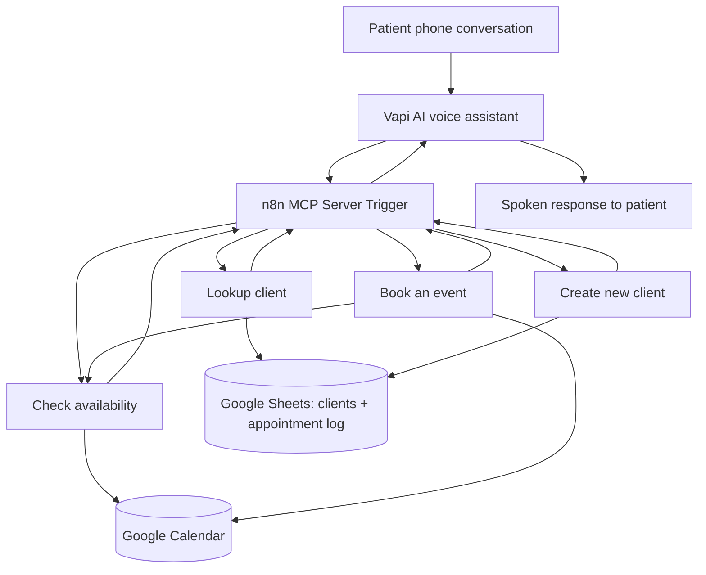

# AI Dental Receptionist | Vapi + n8n + MCP

**An AI-powered dental front-desk automation prototype connecting a conversational voice assistant to patient records and appointment scheduling tools.**

[](https://n8n.io/) [](https://vapi.ai/) [](https://modelcontextprotocol.io/)

> **Project status: Functional prototype / portfolio demonstration.** The repository contains n8n workflow exports. The Vapi assistant configuration and a live phone number are **not** included. This is not a production-ready dental practice system or a HIPAA-compliant deployment.

## Overview

Dental offices frequently handle repetitive calls about appointments, existing patient records, and registration. This project explores how a conversational AI receptionist can coordinate those tasks through reusable automation workflows instead of relying on hard-coded answers.

The design uses **Vapi** as the conversational voice interface, an **n8n MCP Server Trigger** to expose callable tools, **Google Sheets** as a demonstration patient CRM, and **Google Calendar** as the appointment calendar.

### Key capabilities in the exported workflows

| Capability | Implementation | Current status |
| --- | --- | --- |
| AI voice entry point | Vapi is intended to call tools exposed by the n8n MCP server | Integration design; Vapi configuration not included in exports |
| Patient lookup | Search the `clients` sheet by email and branch for existing/new patients | Implemented workflow |
| Patient appointment history | Query an `Appointment log` sheet and check for upcoming entries | Partially implemented; one branch lacks a formatted response |
| New patient registration | Append name, email, and phone to Google Sheets | Implemented workflow; no duplicate check within the create workflow |
| Appointment validation | JavaScript checks ISO 8601 timestamps, future dates, 60-minute duration, weekdays, and start hours | Implemented in availability workflow |
| Calendar availability | Query Google Calendar within an expanded time window and return `is busy` or `is available` | Implemented; requires further edge-case testing |
| Appointment booking | Recheck availability, create a Google Calendar event, return event ID and times | Implemented; end-to-end reliability not yet established |

## 🎥 Live AI Receptionist Demonstrations

This project includes four recorded demonstrations
showcasing the AI Dental Receptionist built with
Vapi, n8n, MCP, Google Calendar, and Google Sheets.

The recordings illustrate conversational AI,
workflow orchestration, and appointment management.

### Demo 1 — AI Voice Receptionist in Action

[▶ Watch Demo 1 on Loom](https://www.loom.com/share/dd8753c96cc249cdafb33796f1432c43)

A walkthrough different parts of the Ai receptionist 

### Demo 2 — AI Voice & RAG

[▶ Watch Demo 2 on Loom](https://www.loom.com/share/74889fe6161d49e682a99ccee84c2301)

Demonstrates How AI can answer questions precisely when giving RAG systems

### Demo 3 — Appointment Availability and Validation

[▶ Watch Demo 3 on Loom](https://www.loom.com/share/6450a83d64a44792938c44b8f53d7559)

Highlights appointment availability checking,
business-hours restrictions, conflict detection,
and conversational handling of unavailable slots.

### Demo 4 — Appointment Booking and Automation
[▶ Watch Demo 4 on Loom]()

## 📸 Vapi AI Receptionist — Live Test Screenshot


The conversation demonstrates:
- Recognition of an already-booked time
- Sunday closure handling
- Rejection of appointments before opening hours
- Suggestions for alternative appointment times

-Project walkthrough  https://www.loom.com/share/dd8753c96cc249cdafb33796f1432c43
-Testing RAG system by Voice AI Receptionist  https://www.loom.com/share/74889fe6161d49e682a99ccee84c2301
-Testing overlap scheduling  https://www.loom.com/share/6450a83d64a44792938c44b8f53d7559
-Appointment Calendar Logging   https://www.loom.com/share/8344f1b3e26e45cfa45adcf1bfd1faa8

**Technology Stack:** Vapi | n8n | MCP |
JavaScript | Google Calendar | Google Sheets


### Demonstrated Features
- Natural voice conversations using Vapi
- Patient lookup through n8n MCP tools
- Appointment availability checks
- Google Calendar appointment booking
- Google Sheets CRM and appointment logging
- Business-hours validation
## Architecture



**Design principle:** Availability checking and event creation are separate operations. A response saying a slot is available is **not** itself a confirmed booking.

## Technology stack

- **Vapi:** Conversational AI voice interface (configured separately from these exports).
- **n8n:** Workflow orchestration, conditional routing, Google integrations, and MCP tool exposure.
- **Model Context Protocol (MCP):** Tool interface linking the voice agent to n8n workflows.
- **Google Sheets:** Lightweight demonstration CRM with `clients` and `Appointment log` tabs.
- **Google Calendar:** Availability queries and event creation.
- **JavaScript:** Validation of appointment timestamps, duration, and operating hours.
- **Luxon / n8n DateTime expressions:** Time-zone-aware calendar query formatting.

## Workflow walkthrough

### 1. Vapi MCP Server

**File:** `workflows/01-vapi-mcp-server.json`

The MCP Server Trigger exposes four workflow tools:

| Tool | Inputs | Purpose |
| --- | --- | --- |
| Lookup client | `email` | Find a patient in the CRM |
| Create new client | `email`, `name`, `phone number` | Append a patient record |
| Check availability | `after_time`, `before_time` | Determine whether a requested one-hour slot is free |
| Book an event | `Start_Date`, `End_Date`, `email`, `Event_Summary` | Attempt booking and return its result |

The availability tool description explicitly warns the assistant **not to confirm a booking from availability alone**.

### 2. Lookup client

**File:** `workflows/02-client-lookup.json`

Receives an email, queries the `clients` worksheet, and branches depending on whether a matching record exists. For existing clients, it queries the `Appointment log` worksheet and evaluates whether appointment dates are upcoming and not marked canceled, completed, or rescheduled. A separate branch returns a message for clients not found in the CRM.

**Current limitation:** The branch for an existing client with a future appointment is not connected to a dedicated response node in the supplied export. The appointment-history logic also depends on dates stored in `MM/DD/YYYY` format and text in the `Notes` column.

### 3. Create new client

**File:** `workflows/03-create-client.json`

Receives `email`, `name`, and `phone number`, then appends a new row to the Google Sheets `clients` tab. The create workflow itself does not enforce uniqueness or validate contact information.

### 4. Check availability

**File:** `workflows/04-check-availability.json`

The workflow runs through these stages:

1. **Input:** Receive `after_time` and `before_time` as ISO 8601 timestamps with explicit UTC offsets.
2. **Validation:** Reject invalid timestamps, dates in the past, reversed time ranges, and durations other than exactly 60 minutes.
3. **Business rules:** Restrict start times to Monday–Friday, 9:00 AM–4:00 PM, interpreted in `America/New_York`.
4. **Buffer:** Compute `buffer_start` as one hour before the appointment and `buffer_end` as one hour after its end.
5. **Calendar lookup:** Fetch events from Google Calendar within that expanded interval.
6. **Decision:** If at least one returned event has an ID, return `is busy`; otherwise return `is available`.

**Example request** (illustrative; use a future weekday when testing):

```json
{
  "after_time": "2026-11-03T10:00:00-05:00",
  "before_time": "2026-11-03T11:00:00-05:00"
}
```

**Example responses:**

```json
{ "status": "is available" }
```

```json
{ "status": "is busy" }
```

**Important nuance:** The one-hour pre/post buffer is a **scheduling restriction**, not a claim that each appointment lasts three hours. The existing implementation checks for any event returned in the buffer window; additional boundary and overlap tests are needed.

### 5. Book an event

**File:** `workflows/05-book-appointment.json`

Receives `Start_Date`, `End_Date`, `email`, and `Event_Summary`, then:

1. Calls the **check availability** workflow using the requested start and end.
2. Tests whether the response status is exactly `is available`.
3. On the available branch, creates a Google Calendar event with start, end, attendee email, and summary.
4. Returns `booking_confirmed` with event ID and appointment times if event creation succeeds.
5. Otherwise returns `booking_rejected_busy`.

This recheck helps reduce double-booking risk, but **is not an atomic reservation lock**. Two concurrent requests can still pass availability checks before either creates its event.

## Example patient interaction

*Illustrative conversation showing the intended agent behavior, not a recorded transcript:*

> **Patient:** Hi, I'd like a dental appointment next Tuesday at 10 AM.  
> **AI Receptionist:** I can check that time. May I have your email address?  
> **Patient:** alex@example.com.  
> **AI Receptionist:** I'll look up your record and check the calendar.  
> **AI Receptionist:** That time is available. Would you like me to book it?  
> **Patient:** Yes, please.  
> **AI Receptionist:** I'll submit the booking now. [Calls the booking tool.] Your appointment is confirmed **only if the booking tool reports success**.

## Repository structure

```text
.
├── README.md
├── LICENSE
├── .gitignore
├── workflows/
    ├── 01-vapi-mcp-server.json
    ├── 02-client-lookup.json
    ├── 03-create-client.json
    ├── 04-check-availability.json
    └── 05-book-appointment.json
```

Additional project documentation: [`docs/architecture.md`](docs/architecture.md), [`docs/demo-script.md`](docs/demo-script.md), and [`docs/resume-linkedin.md`](docs/resume-linkedin.md). See [`SANITIZATION_NOTES.md`](SANITIZATION_NOTES.md) before publishing.

*The paths above are the recommended repository layout; adjust names if your uploaded files differ.*

## Setup (developer demonstration)

1. Create an n8n instance and connect **Google Sheets OAuth** and **Google Calendar OAuth** credentials.
2. Create a demonstration Google Sheet with a `clients` worksheet (at least `email`, `name`, `phone`) and an `Appointment log` worksheet containing the columns used in the lookup logic (including `email`, `Appointment date`, and `Notes`).
3. Create or select a test Google Calendar. Do **not** use real patient information for portfolio demonstrations.
4. Import the four subworkflows into n8n, then import the MCP Server workflow.
5. Reconfigure the Google Sheets document and tab selections, Google Calendar selection, credentials, and **Execute Workflow / Tool Workflow references**. Imported workflow IDs will differ from the original instance.
6. Ensure the workflow inputs and tool parameter names match exactly (`after_time` vs. `before_time`; `Start_Date` vs. `End_Date`; `phone number` contains a space).
7. Connect your Vapi assistant to the n8n MCP endpoint using your own secure integration configuration. This repository does not contain a Vapi assistant export or deployment credentials.
8. Test patient lookup, new-client creation, available-slot responses, busy-slot responses, booking confirmation, and rejection. Inspect n8n execution logs and Google Calendar results.

### Suggested tests

| Test | Expected behavior |
| --- | --- |
| Existing email | Existing patient branch |
| Unknown email | New-client message |
| Create a test patient | New row in `clients` sheet |
| Valid free weekday slot | `is available` |
| Slot overlapping a calendar event or buffer | `is busy` |
| Past date | Validation error |
| Weekend | Validation error |
| Appointment duration other than 60 minutes | Validation error |
| Book an occupied slot | `booking_rejected_busy`; no new event |
| Book a free slot | Calendar event created, then `booking_confirmed` |

These are **test cases to execute**, not a claim that every case has passed.

## Engineering decisions and limitations

- **Modular tools:** Lookup, registration, availability, and booking are separate n8n workflows that can be maintained independently.
- **Structured outputs:** The workflows return status strings that a voice agent can interpret rather than relying solely on natural-language guesses.
- **Time zones:** Availability logic uses `America/New_York` and expects timestamp offsets. Vapi prompting must also handle daylight saving time correctly.
- **Validation:** The availability workflow rejects invalid requests, but the exported booking flow has not been independently proven safe against every failure or concurrent booking scenario.
- **Calendar semantics:** Returned events are treated as conflicts; free/busy status, all-day events, canceled events, recurrence, boundary equality, and permission errors need explicit production tests.
- **Error handling:** Invalid inputs may throw workflow errors rather than returning patient-friendly structured messages.
- **Patient lookup:** One upcoming-appointment branch has no dedicated final response node.
- **CRM quality:** The Sheets-backed prototype lacks duplicate prevention, transactional writes, and robust phone/email validation.
- **Scope:** No verified SMS confirmations, cancellations, rescheduling, dashboard approvals, insurance verification, or integration with a dental practice-management system is present in the supplied exports.
- **Concurrency:** Rechecking availability does not guarantee protection against simultaneous requests. Production deployment would require locking or an authoritative booking API with conflict guarantees.

## Security and privacy

**Demonstration only.** Do not store real patient health information in an unapproved Google Sheet or publish patient records, call recordings, tokens, credentials, webhook URLs, calendar IDs, or production resource identifiers. A real dental deployment would require a formal security/privacy review, appropriate vendor agreements and HIPAA compliance assessment where applicable, least-privilege access, audit logging, retention controls, and secure identity verification.

**Before publishing n8n JSON:** remove or replace embedded Google Sheet IDs and URLs, calendar email addresses, credential IDs/names, webhook/MCP paths, instance IDs, pinned sample records, and other environment-specific details. If secrets have already been published, revoke or rotate them; deleting a file in a later commit does not erase Git history.

## Roadmap

- [ ] Add reliable patient-friendly error responses and finish the upcoming-appointment lookup branch.
- [ ] Add unit and end-to-end tests for DST transitions, calendar event boundaries, recurrence, and failures.
- [ ] Prevent duplicate patients and implement robust contact-field validation.
- [ ] Add concurrency-safe booking through an authoritative booking system.
- [ ] Add rescheduling, cancellation, and patient consent flows.
- [ ] Add optional SMS/email confirmations and human receptionist escalation.
- [ ] Support clinic-specific practice-management systems and assisted booking.
- [ ] Add monitoring, audit logs, and secure deployment controls.

## Portfolio demonstration

**Demo video:** *Add Loom link here*  
**Architecture screenshot:** *Add diagram or n8n screenshots here*  
**GitHub repository:** [AI Dental Receptionist](https://github.com/sarahsuegirl/Ai-dental-receptionist-vapi-n8n-mcp)

### What this project demonstrates

Workflow orchestration, tool-based AI integration, API/service connectivity, JavaScript validation, data-driven decision logic, CRM operations, calendar automation, and practical analysis of real-world scheduling edge cases.

---

**Built as an AI automation / AI Solutions Analyst portfolio project.**
