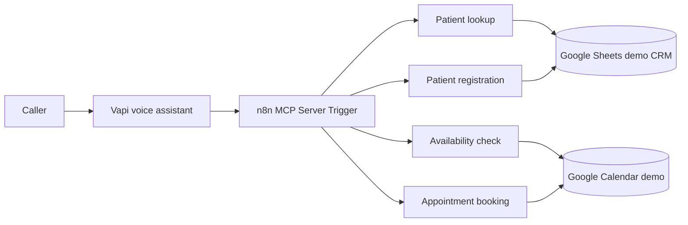

# AI Dental Receptionist — Vapi + n8n + MCP

**Portfolio prototype | Voice AI · Workflow Automation · CRM · Calendar Integration**

A conversational dental-office receptionist prototype that routes caller requests from a **Vapi voice assistant** through an **n8n MCP server** to Google Sheets and Google Calendar workflows. Built to explore voice-driven intake, patient lookup, registration, availability checks, and appointment creation.

> **Project status:** Prototype / work in progress. Patient lookup has been demonstrated in testing. Calendar validation and reliable booking need additional work before deployment. This repository is **not** a production healthcare system and uses no real patient records.

## Architecture

See [architecture diagram](docs/architecture.md).

## Exported workflows

| File | Purpose |
|---|---|
| `workflows/01-mcp-server.json` | Exposes four workflow tools via an n8n MCP trigger |
| `workflows/02-patient-lookup.json` | Searches Google Sheets for a patient and appointment-log entries |
| `workflows/03-patient-registration.json` | Appends a new patient to a Sheets CRM |
| `workflows/04-calendar-availability.json` | Queries Google Calendar and returns a busy/available status |
| `workflows/05-appointment-booking.json` | Creates a Google Calendar event (requires mapping fixes and further testing) |

## Technology

**Vapi** (voice interface), **n8n** (orchestration), **Model Context Protocol / MCP** (tool exposure), **Google Sheets** (demo CRM), **Google Calendar** (scheduling).

## What has been demonstrated

- MCP-connected voice assistant invoking n8n tools.
- Existing-patient email lookup in Google Sheets.
- Retrieval of appointment-log rows.
- Calendar availability workflow returning structured status.

## Known limitations and engineering next steps

1. **Date correctness:** The availability workflow does not reject past dates. A test tool invocation sent a 2023 date when a 2026 appointment was intended. Add server-side ISO 8601 parsing, timezone-aware future-date validation, weekday/business-hours checks, and explicit invalid-input responses.
2. **Scheduling rules:** Current availability only checks events inside the requested interval; it does **not** enforce a one-hour buffer before/after. Query the expanded conflict interval and handle all-day/recurring events.
3. **Booking input mismatch:** The MCP booking tool maps `Start_Date`/`End_Date`, while the booking subworkflow declares `Start_Time`/`End_Time`. Align names and map start/end explicitly into the Google Calendar Create Event node.
4. **Prevent double booking:** Re-check availability immediately before creating an event and use a locking/idempotency strategy for simultaneous requests.
5. **Lookup response completeness:** The lookup workflow has an unconnected true branch for appointment records; return a normalized structured response from every branch and distinguish past/completed from upcoming appointments.
6. **Registration quality:** Change phone numbers from numeric to string, validate email/phone, and check for duplicate patient profiles before appending.
7. **Security:** Secure MCP access, use minimum-privilege Google credentials, protect sensitive records, and add appropriate logging/retention policies. **Do not use real patient information or claim HIPAA compliance.**
8. **Email confirmation and cancellation:** Not included in the five exported workflows; treat as future features, not demonstrated capabilities.

## Setup for reviewers (conceptual)

1. Create a **synthetic-data-only** Google Sheet with `clients` and `Appointment log` tabs, and a dedicated demo Google Calendar.
2. Import the five JSON files into n8n. These files are sanitized examples; reconnect Google credentials and select the demo spreadsheet, sheets, and calendar.
3. Reconfigure each `Call Workflow` tool in the MCP Server workflow to reference the newly imported workflow IDs.
4. Configure a new MCP endpoint and authentication. Connect Vapi to that endpoint, using a dedicated demo assistant.
5. **Do not enable real appointment booking until the issues above are fixed and tested.**

The exports are deliberately inactive, with credentials, private resource IDs, original endpoint path, and pinned test records removed. They are meant for architecture review, **not** as immediately deployable workflows.

## Demo / interview walkthrough

See [demo script](docs/demo-script.md). A short recording can show the Vapi call, n8n execution trace, a synthetic patient lookup, and a clear explanation of calendar validation still in progress.

## Privacy and scope

No patient dataset, API keys, tokens, credential IDs, personal Google account identifiers, or live MCP endpoint is intentionally included in this repository. Use dummy names, emails, and phone numbers in any screenshots or recordings. This prototype is not suitable for handling protected health information.
