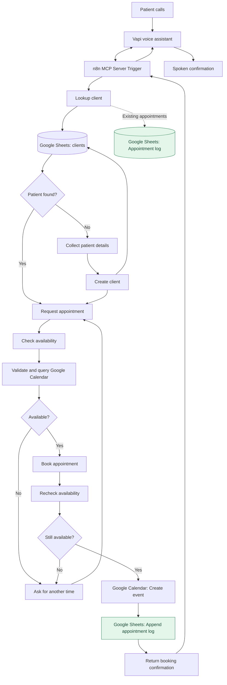

# AI Dental Receptionist — System Architecture

**Project type:** Voice AI and workflow automation portfolio prototype  
**Stack:** Vapi · Model Context Protocol (MCP) · n8n · JavaScript · Google Sheets · Google Calendar  
**Source of truth:** Five sanitized n8n workflow exports in `workflows/`.

## 1. Executive overview

The AI Dental Receptionist is a voice-first assistant prototype that connects a conversational interface (Vapi) to business operations through an n8n MCP server. The assistant can request patient lookup, patient registration, appointment availability, and appointment booking using dedicated workflow tools. Google Sheets acts as a lightweight demonstration CRM and appointment log; Google Calendar supplies schedule information and event creation.

The exported workflows establish the integration design and specific automation rules. They are **not** evidence of a production-ready healthcare system or a fully race-condition-safe scheduler.

## 2. Architecture diagram



The booking workflow calls the availability workflow **again** immediately before event creation. The standalone availability tool only checks a slot; it does not create a booking.

## 3. Workflow inventory

| Sanitized export | Entry point | Core behavior | Output / result |
|---|---|---|---|
| `01-vapi-mcp-server.json` | MCP Server Trigger | Exposes four subworkflow tools to the voice agent | Tool-specific responses |
| `02-client-lookup.json` | Executed by Another Workflow | Looks up a client by email in the `clients` sheet; queries an appointment log for existing clients | New-client message or client/appointment-related response |
| `03-create-client.json` | Executed by Another Workflow | Appends client name, email, and phone to Google Sheets | Google Sheets append result |
| `04-check-availability.json` | Executed by Another Workflow | Validates proposed time, queries Google Calendar, and branches on event count | `is busy` or `is available` |
| `05-book-appointment.json` | Executed by Another Workflow | Rechecks availability; creates an event only when available | `booking_confirmed` or `booking_rejected_busy` |

### MCP tool contracts

The MCP server uses n8n **Call Workflow Tool** nodes to expose client lookup, client creation, availability checking, and booking. Tool inputs are populated by Vapi's AI tool-call parameters. Some field names differ between tools and must be mapped exactly.

- **Client lookup:** email (lookup workflow also declares optional `Phone number` and `Name` inputs).
- **Create client:** email, name, `phone number`.
- **Availability:** `after_time`, `before_time` (ISO 8601 timestamps with explicit offsets).
- **Booking:** `Start_Date`, `End_Date`, `email`, `Event_Summary`.

## 4. Availability and booking rules

The `Code in JavaScript` node in the availability workflow validates the following:

1. Both timestamps are ISO 8601 strings with explicit time-zone offsets.
2. Start and end are parseable dates; the start is in the future and the end follows the start.
3. Appointments are exactly **60 minutes** long.
4. The appointment starts on **Monday–Friday** between **9:00 AM and 4:00 PM** in `America/New_York`, corresponding to a stated 9 AM–5 PM clinic schedule.
5. It derives a **one-hour buffer before the start and after the end** and queries Google Calendar over that enlarged interval.

The Calendar **Get Many** node expands recurring events and queries the configured calendar. The following `If` node counts returned items with event IDs. Any such item routes to `Busy` (`status: "is busy"`); no event ID routes to `Available` (`status: "is available"`). The booking workflow compares the returned status to `is available` and only then calls **Create an event**. A successful event-creation response is transformed into `booking_confirmed`, `event_id`, `appointment_start`, and `appointment_end`.

**Interpretation of buffer:** The exported workflow treats an event found anywhere in the extended interval as a conflict. That is stricter than simply preventing overlapping one-hour appointments.

## 5. Patient data flow

**Existing patient:** Vapi supplies an email → MCP lookup tool → Google Sheets `clients` lookup → for a found client, additional query to the `Appointment log` sheet → workflow response to the assistant.

**New patient:** Vapi collects name, email, and phone → MCP create-client tool → Google Sheets append-row operation → tool response to the assistant.

The lookup workflow contains branches for a new client and for an existing client with no upcoming appointment. Its exact responses should be verified with realistic test data; do not assume every branch is complete without testing.

## 6. Security, privacy, and deployment boundaries

The public JSON exports replace account identifiers, spreadsheet IDs, credential references, workflow IDs, and MCP endpoint values with placeholders. To run the project, a developer must restore **their own** credentials, spreadsheet references, calendar selection, workflow references, and MCP path. Never commit API tokens, private endpoint URLs, or real patient data.

Google Sheets is used here as a **demo CRM**, not a claimed HIPAA-compliant patient records system. A real dental-office deployment would require a documented security and compliance review, appropriate vendor agreements, access controls, audit logs, retention rules, and handling of sensitive patient information.

## 7. Known limitations and engineering roadmap

- **Race conditions:** Checking availability before event creation reduces accidental conflicts but is not atomic. Two simultaneous requests may both pass the check. Production deployment requires a transactional reservation/locking strategy or a booking system with atomic slot holds.
- **Calendar event semantics:** The current `Get Many` logic counts any returned event with an ID as busy. Confirm how cancelled, transparent/free, and all-day events should behave; verify calendar query boundaries and recurrence handling.
- **Date/time handling:** The JavaScript validator uses `America/New_York`; test daylight-saving transitions and ambiguous local times. The exported validator checks the *start* business hour; confirm that future rule changes also validate the full interval.
- **Error handling:** Validation currently throws errors for invalid input. A production assistant should receive structured, caller-friendly error codes and recovery prompts.
- **Input quality:** Confirm field-name consistency, phone-number treatment as text (not numeric), email normalization, and duplicate patient handling.
- **Observability:** Add request IDs, safe logging, retry policies, monitoring, and human escalation.
- **Integration testing:** Validate live Vapi → MCP → subworkflow → Google Calendar/Sheets flows; remove pinned mock data before using test results as proof of a live booking.
- **Privacy:** Use fictional demo patients and a dedicated test calendar; do not expose private contacts or real patient details in a public video.

## 8. Recommended acceptance tests

| Scenario | Expected result |
|---|---|
| Existing email in CRM | Existing-client lookup path |
| Unknown email | New-client message; registration offered |
| New patient details | New row appended to demo `clients` sheet |
| Valid, free weekday one-hour slot | `is available` |
| Event overlaps requested slot or configured buffer | `is busy` |
| Weekend or outside business hours | Validation error; no event created |
| Past date, invalid offset, or duration other than 60 minutes | Validation error; no event created |
| Booking a busy slot | `booking_rejected_busy`; no new event |
| Booking a free slot | Event created, then `booking_confirmed` with event ID and times |
| Two concurrent bookings for same slot | **Not guaranteed safe yet**; must be addressed before production |

## 9. Repository structure

```text
Ai-dental-receptionist-vapi-n8n-mcp/
├── README.md
├── workflows/
│   ├── 01-vapi-mcp-server.json
│   ├── 02-client-lookup.json
│   ├── 03-create-client.json
│   ├── 04-check-availability.json
│   └── 05-book-appointment.json
├── docs/
│   ├── architecture.md
│   ├── demo-script.md
│   └── resume-linkedin.md
├── SANITIZATION_NOTES.md
├── .gitignore
└── LICENSE
```

**Project status:** Working prototype components and demonstrated workflow branches; full production reliability and compliance are out of scope for the current portfolio release.
